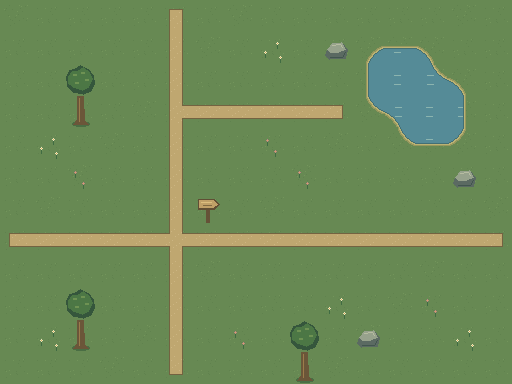

# 32px field crossing — native Tiled study

A self-initiated, code-authored capability study by Hx Works: a 16 × 12 orthogonal map built from reusable 32 × 32 pixel tiles. The atlas contains 40 tiles, including road connections, corner-based water transitions and transparent decorations.



## Editable files

- [Tiled map](field-crossing.tmj)
- [External tileset](tiles.tsj) and [PNG atlas](tiles.png)
- [Python/Pillow source](build_study.py)

Keep these files together so the relative image and tileset references resolve. Separate layers contain `ground`, `decor`, `objects`, `above-player` and `collision`. The object layers include a spawn point, sign interaction region, and water/rock geometry annotations.

## Actual checks

The Windows release of Tiled 1.12.2 read the map, exported its tileset to TSX, converted the map through TMX and back to TMJ, and produced the preview above. Tile IDs, layer names and object geometry survived that round trip. A spawn point moved from x=144 to x=176 in an edited copy also survived native export and reopening; the original map stayed unchanged. This was a file-level/native CLI test.

The source checks cover 256 compatible road-edge pairs, 128 compatible water-edge pairs and 356 neighbouring edges in this map. The native render and an independent image composite differ at 108 pixels by at most one 8-bit colour level; their alpha channels match.

To regenerate the source files with Python and Pillow:

```sh
python build_study.py
```

With Tiled installed, its native tools can render and convert the files:

```sh
tmxrasterizer --no-smoothing --hide-object-layers field-crossing.tmj preview.png
tiled --export-map field-crossing.tmj check.tmx
tiled --export-map check.tmx check.tmj
```

## Scope

This small study demonstrates source structure and terrain connections. GUI editing, engine import, playable collisions, animation and Wang-set automapping have not been tested. The graphics are produced by the supplied script; they are not a hand-painted commission, a completed village, or client work. Art direction and production requirements need their own review.

Demonstration only. This folder grants no licence for reuse in a product. Project scope, editable-source handover and any reuse rights must be agreed separately with Hx Works.
