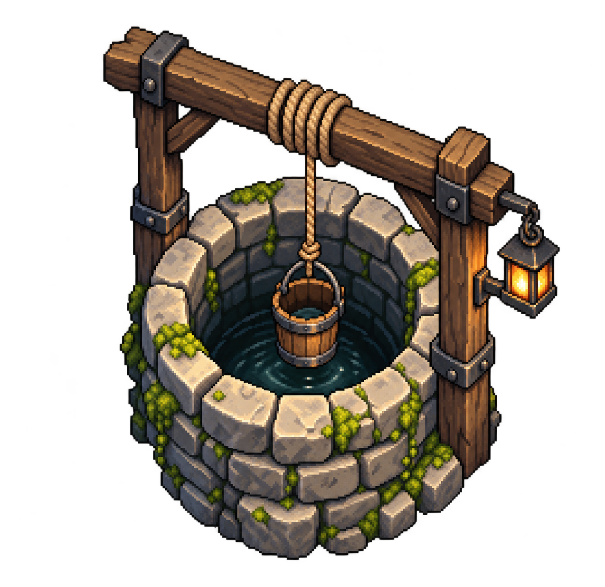

# Three-quarter environment prop study

A self-initiated stone-well concept by Hx Works, made with an AI-assisted raster workflow. It is a style study, not paid client work or a finished game asset.

## What this shows

A three-quarter-view prop silhouette, with the well opening, hanging bucket, stone texture and warm lantern visible. The original PNG is **1274 × 1235 RGBA**. We inspected it on light and dark backgrounds at 96 and 160 CSS pixels; the main objects remain recognizable and small detail becomes less clear.

## Limits

This is pixel-inspired raster concept art, **not a strict pixel-grid sprite or a native 32 × 32 reusable tileset**. It has partially transparent edge pixels and inconsistent pixel-cluster sizes. There is no layered drawing source, tile-seam, map-scale, collision, animation or engine acceptance claim. The beam/rope arrangement is illustrative, not a verified working winch.

The exact generation prompt is in [generation-prompt.txt](generation-prompt.txt). No client reference images or private files were used. This page does not promise exclusive copyright, transfer rights to a particular customer, or grant a reuse licence. Rights and any tool restrictions need agreement before paid work.

## Separate tile-format study

[Native 32 × 32 tile-format study](../native-tiled-field-study/) contains an original code-authored modular map, tiles and native Tiled files. It demonstrates file structure and bounded native export checks; its simple orthographic art is separate from the visual concept above. Neither example demonstrates a complete commissioned village.
