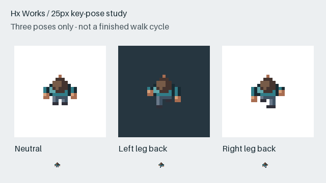
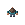

# 25px overhead key-pose study — Hx Works

A self-initiated pixel-coordinate study, with three key poses of a fictional
north-facing character. This is not a client commission or a finished walk cycle.

## Limited pose preview

 

The GIF alternates neutral / left-leg-back / neutral / right-leg-back at
180 ms per displayed pose. It has four displayed frames and only three unique
poses. It does **not** demonstrate an eight-frame walk, a natural completed gait,
all facing directions, running, aiming, punching, sliding or game integration.

## Source and exports

- Every working frame is **25 × 25 pixels**, with **10 opaque colours** and
  binary transparency. The hair, skin, clothing and trouser colours have separate
  roles in the [grid and palette source](grid-source.json).
- [Three-pose PNG sheet](three-key-poses.png): **75 × 25 pixels**, without padding.
- [Python source](build_study.py) renders the same coordinate grid to PNG and
  ordinary SVG pixel rectangles. No game sprite, reference-image pixel, stock
  character or image-model artwork is imported.
- [Export checks](metrics.json) cover dimensions, palette, transparency and the
  fixed head region. They do not prove artistic quality or buyer acceptance.

To regenerate the PNG, SVG and preview exports, run `python build_study.py`
with Python and Pillow **12.2.0** from this folder. Outputs are written beside
the script. The script also checks the four composed GIF frames against the
corresponding PNG grids.

The first internal geometry looked too much like a standing rear view; the
published study foreshortens the body and legs. The intended viewing angle,
silhouette and final animation timing still need a client's review.

This public sample is for inspection. It is not a promise of copyright
assignment, exclusive rights or a completed commercial asset. Any commissioned
scope, workflow, output formats, usage rights, fee and delivery date would be
agreed separately before work starts.
